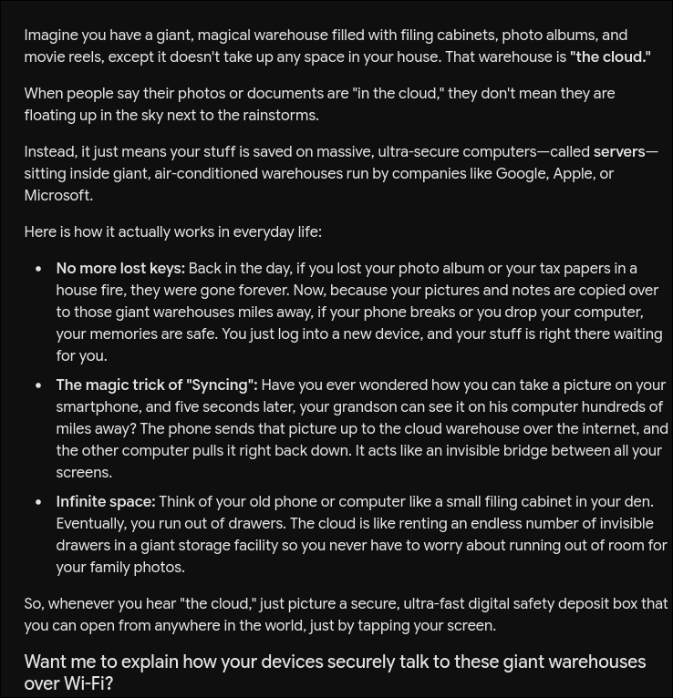
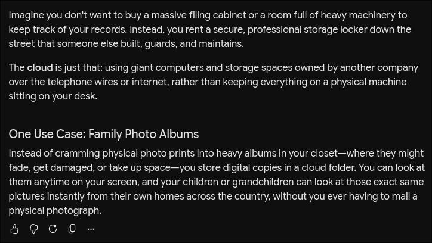

# Section 1

| bad | problem | good |
| --- | --- | --- |
| Fix my laptop | Too vague ignoring limitations | Diagnose the issue with my laptop. It is a *brand model year* laptop and it is *issue* and showing *symptom* |
| Who will win the stanley cup next season | Ignoring limitations | Given the history of the stanly cup and trends within the teams, list the teams that are most likely to win. For example, if a good trade happened give them a higher rating |
| Why wont it open | Too vague assume knows context | Give me possible reasons that *app* may not open. I am running *version* on *os* |
| Tell me about healthy breakfasts | output not specified | I am preparing a shopping list to make a healthy breakfast. Give me a list of ingredients that could be made into a healthy breakfast |
| Plan my 7-day trip to Japan, make a full budget, write a packing list, teach me basic Japanese phrases, and write a 1,000-word history of Tokyo | Overloading No context | Help plan my 7 day trip to *region* of Japan I have a budget of *amount* and I need a budget for vistas I may visit in *region*. I also need a packing list with what I should bring (i.e clothes for weather). |

# Section 2

S3: Explain what "the cloud" is to your grandparent.

Explain the cloud to my grandfather

Explain what a cloud enviroment is to my grandfather. Explain only one use case. The explination should be short. Use examples that someone that was in their 60s when computers became commecially available would understand. Avoid explaining intricate details, just give the overview. (i.e) the cloud is like using someone elses cabinate or calculator...

# Section 3

| Criteria | Check ($\checkmark$ / $\times$) | Evaluation / Justification | 
| ----- | ----- | ----- | 
| **Context** | $\checkmark$ | Defines the target persona clearly ("my grandfather") and specifies their demographic context ("in their 60s when computers became commercially available"). | 
| **Task** | $\checkmark$ | Explicitly states the primary actions required: "Explain what a cloud environment is" and "Explain only one use case." | 
| **Format** | $\checkmark$ | Specifies structural requirements by asking for a "short" overview without deep technical details. | 
| **Example** | $\checkmark$ | Includes concrete reference examples: `(i.e) the cloud is like using someone elses cabinate or calculator...` | 
| **Constraints** | $\checkmark$ | Sets clear boundaries: limit to a single use case, keep it brief, avoid intricate technical details, and tailor the language to a specific age demographic. | 
| **Technique** | $\times$ | No formal prompt engineering technique (e.g., Few-Shot, Persona, Chain-of-Thought) is explicitly named or requested within the prompt text. | 

Explicitly specify the desired output format and structure (e.g., asking for a two-paragraph structure or specific headings) to ensure the AI doesn't add extra conversational filler.

* **Example addition to prompt:**

  *"Structure the response in two short paragraphs: Paragraph 1 should explain the core concept using a 1970s/1980s real-world analogy (like a bank safe deposit box), and Paragraph 2 should outline the single use case."*